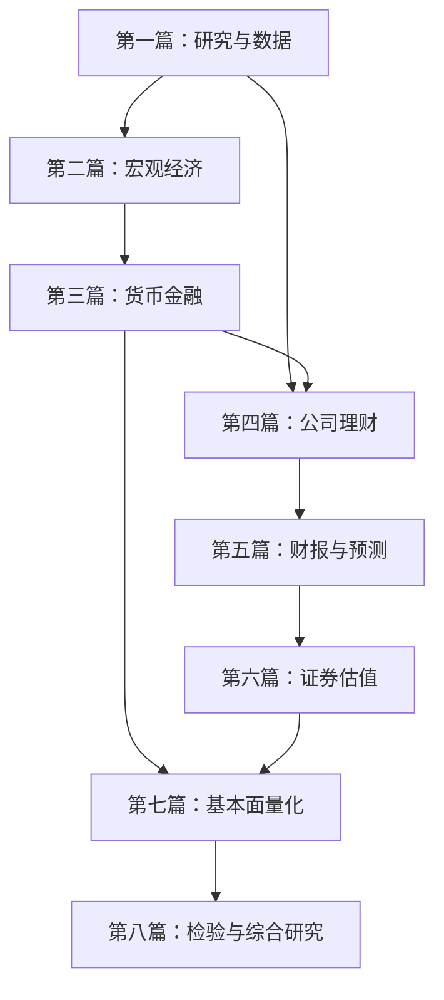

# 学习路线与先修关系

## 完整路线

顺序学习40章，每章完成核心推导、核心练习与解释任务；项目在对应篇末验收。每次学习不要求覆盖整章。数据实验可拆为数次，学习进度取决于实际掌握。

图表示篇级主线；逐章具体先修以[课程总纲](SYLLABUS.md)为准。熟悉公司理财的读者可在完成1—5章后先复习第四篇，再补货币金融；使用资本成本前仍需利率和风险基础。

## 三条专题路线

| 路线 | 核心顺序 | 成果 |
| --- | --- | --- |
| 宏观与产业研究 | 1—5 → 6—15 → 21、25、30 | 宏观简报与企业传导情景 |
| 企业研究与估值 | 1—5 → 13、16—30 | 财务诊断与两种估值模型 |
| 基本面量化 | 1—5 → 18、21—24、28 → 31—38 → 39、40 | 含成本与样本外检验的研究 |

跳读只表示路线选择，不自动豁免关键技能。进入量化前应能解释因子口径与财报时点；进入估值前应能贯通现金流、资本成本与再投资。

## 30天快速复习映射

这是面向已有基础读者的**选读路线**。宏观40分钟、企业40分钟、衔接与退出题10分钟；量化小练习嵌入所选环节，超过时间顺延。按学习者实际回答推进，不按日历强制跳课。下面是全部内容完成后的映射，目前仅第1章可完整阅读。

| 课次 | 宏观线选读 | 企业线选读 | 衔接任务 |
| --- | --- | --- | --- |
| 1 | 1研究框架 | 1价值与现金流 | 写一个可检验问题 |
| 2 | 6核算 | 21商业模式 | 需求来源 |
| 3 | 6景气指标 | 21利润表 | 量价成本 |
| 4 | 6价格与8冲击 | 21资产负债表 | 成本与库存 |
| 5 | 7就业与生产率 | 21现金流表 | 工资与现金 |
| 6 | 9消费储蓄 | 21三表勾稽 | 利润与回款 |
| 7 | 6—9复盘 | 21复盘 | 历史底稿 |
| 8 | 7增长 | 23盈利能力 | 增长质量 |
| 9 | 9投资 | 20周转 | 扩张占款 |
| 10 | 9房地产 | 23杜邦 | 经营与杠杆 |
| 11 | 14财政 | 23资本回报 | 政策与ROIC |
| 12 | 14政策工具 | 19融资 | 利率传导 |
| 13 | 11货币 | 24会计质量 | 口径核查 |
| 14 | 12信用 | 22—24诊断 | 宽货币与回款 |
| 15 | 13利率曲线 | 25收入预测 | 假设依据 |
| 16 | 8供需冲击 | 17资本开支 | 扩产可行性 |
| 17 | 8 IS—LM | 20、25营运资本 | 需求压力 |
| 18 | 14预期 | 26自由现金流 | 再投资约束 |
| 19 | 10国际收支 | 18资本成本 | 币种一致 |
| 20 | 15汇率 | 26终值 | 稳态条件 |
| 21 | 15外部金融 | 26 DCF | 敏感性 |
| 22 | 9周期 | 28倍数 | 周期低PE |
| 23 | 12金融周期 | 29银行 | 资本约束 |
| 24 | 10贸易条件 | 29周期行业 | 正常化利润 |
| 25 | 7长期增长 | 29成长公司 | 成熟期假设 |
| 26 | 13、14资产价格 | 29 SOTP | 价值桥接 |
| 27 | 14、15情景 | 30反向估值 | 市场隐含预期 |
| 28 | 6—15整合 | 25—30整合 | 两份报告 |
| 29 | 5因果与反方 | 24、30模型审阅 | 三条改判条件 |
| 30 | 40宏观迁移 | 40企业迁移 | 闭卷迁移测试 |

27章剩余收益及31—39章的系统量化研究在完整路线中完成，30天选读不宣称覆盖这些能力。

## 掌握标准

每个主题从概念、计算、证据、机制与反例四方面检查。必须能说明数字的含义、重算关键步骤，并说出何种证据会推翻判断。完成阅读、运行代码或收到提醒均不等同验收。
